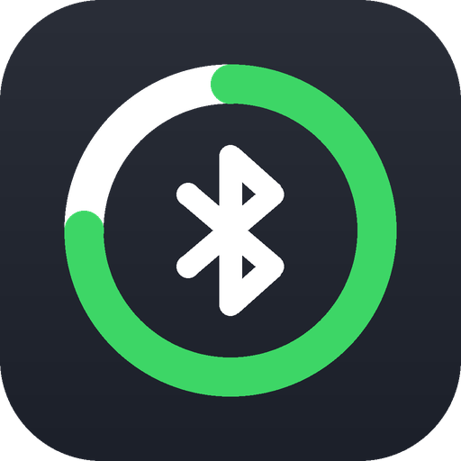

# MonitorBT



Mostra na bandeja do Windows a bateria dos dispositivos Bluetooth, com um ícone por dispositivo (anel + %).

- O anel é verde a partir de 50%, amarelo de 20 a 49% e vermelho abaixo de 20%. Em 100% o anel fica cheio, sem número.
- Clique esquerdo ou direito em qualquer ícone abre o menu: mostrar/ocultar dispositivo, Atualizar agora, Iniciar com o Windows e Sair.
- A leitura é feita a cada 5 minutos e também ~4 s depois que um dispositivo conecta ou desconecta.
- Um aviso de bateria baixa aparece uma vez por descarga quando o nível fica abaixo do limiar.

## Instalação

Basta abrir o `monitorbt.exe`. Na primeira execução ele oferece se instalar em `%LOCALAPPDATA%\Programs\MonitorBT\`. É uma instalação por usuário e não pede administrador. Depois ele liga o início com o Windows e abre a cópia instalada. O arquivo baixado pode ser apagado.

Para atualizar, abra o `.exe` novo e responda "Sim": a versão instalada é fechada e substituída. Se você responder "Não" na primeira vez, o app roda de onde está e não pergunta de novo (`ask_install=0` no config).

## Build

Toolchain: Rust `stable-x86_64-pc-windows-gnu`. Não precisa de Visual Studio.

```
cargo build --release
```

O executável fica em `target\release\monitorbt.exe` (~350 KB). Para usar, copie-o para uma pasta fixa e ligue "Iniciar com o Windows" pelo menu.

A crate `windows` está fixada em 0.58 de propósito. A partir da 0.61 ela usa `raw-dylib`, que no toolchain GNU exige `dlltool` + `as` (binutils). Esses não vêm no rustup.

## Ícone do .exe

O logo fica em `assets/monitorbt.ico`, gerado por `python assets/logo.py`. O `build.rs` embute o ícone no executável a cada build: sem `windres`, ele monta o recurso direto em Rust. Para trocar o logo, substitua o `.ico` e recompile.

## Config

O arquivo é `%APPDATA%\monitorbt\config.ini` e é criado ao ocultar um dispositivo:

```
threshold=20      # % do aviso de bateria baixa
interval_min=5    # intervalo de leitura
hidden=2CDA46E97245
```

## Testes / debug

- `cargo test`: gera prévias dos ícones em `target\icon-preview\`.
- `cargo test scan -- --ignored --nocapture`: lista os dispositivos e a bateria vistos agora.
- No build de debug, `MONITORBT_FAKE="Fone:92,Mouse:45,Xbox:12"` simula dispositivos.

## Limitações

- O app lê a bateria que o Windows expõe (a mesma de Configurações > Bluetooth) e, para BLE, o GATT Battery Service.
- Controles que só enviam a bateria dentro do relatório HID, como o DualSense, não aparecem.
